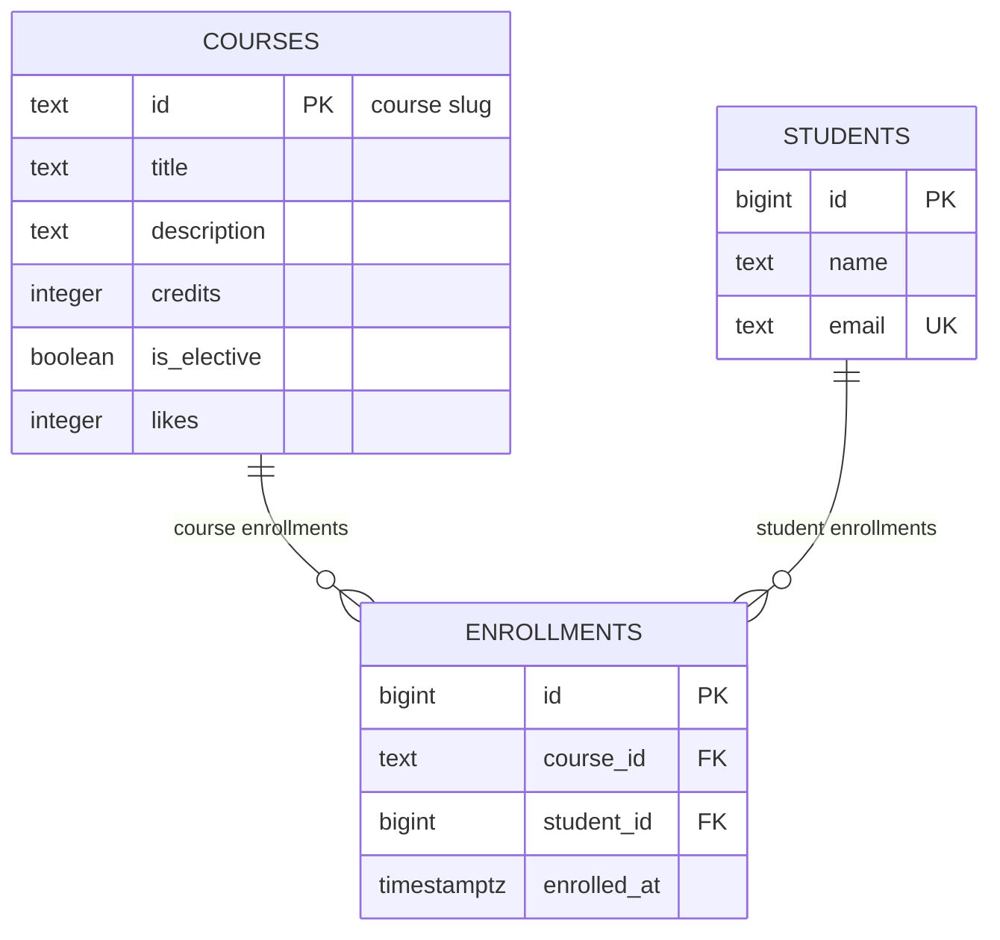

# course-catalog-db

PostgreSQL schema for the course catalog (Lab 6, “Advanced Web Technologies”).

## How to run

PostgreSQL 16 or newer is required (checked on 17.11). Once, as the
`postgres` superuser:

```sql
CREATE ROLE catalog_app LOGIN PASSWORD 'change-me';
CREATE DATABASE course_catalog OWNER catalog_app;
-- for the index experiment (step 6):
CREATE DATABASE idx_demo OWNER catalog_app;
```

Then, from the project folder (it stops at the first error):

```bash
psql -h localhost -U catalog_app -d course_catalog -v ON_ERROR_STOP=1 -f schema.sql
psql -h localhost -U catalog_app -d course_catalog -v ON_ERROR_STOP=1 -f seed.sql
psql -h localhost -U catalog_app -d course_catalog -v ON_ERROR_STOP=1 -f queries.sql
```

After `schema.sql` and `seed.sql` the tables hold 6 courses, 3 students and
6 enrollments. The password `change-me` is for teaching; real projects keep
passwords out of git.

## Schema



There are three tables: `courses`, `students` and `enrollments`. Each course
and each student can have many enrollments, and each enrollment belongs to
exactly one course and one student (two one-to-many relationships). Together
they form a many-to-many relationship between students and courses, and
`enrollments` is the table that stores it; `UNIQUE (course_id, student_id)`
makes sure a student enrolls in a course only once.

## Design decisions

- **`courses.id` is a text slug, `students.id` is an automatic number.** A
  course already has a natural, stable and readable identifier that is used
  in URLs (`/courses/web-security`) and in the frontend, so a slug is
  convenient: links are readable and no extra lookup is needed. The downside:
  it's longer than a number, and changing a slug would mean updating all the
  foreign keys. Students have no such natural key (a name isn't unique, an
  email can change), so the database issues a `bigint` number: it's compact,
  fast and never changes, but it means nothing to a human and has gaps.
- **`RESTRICT` on `enrollments.course_id`, `CASCADE` on
  `enrollments.student_id`.** A course with enrollments is important data —
  deleting it by accident would silently remove the history of all its
  students, so the database forbids it (the API answers 409). Enrollments
  belong to the student: if a student is deleted (for example, at their own
  request), their enrollments make no sense anymore and are removed with them.
- **`timestamptz`, not `timestamp`; `text`, not `varchar(n)`.**
  `timestamptz` stores an exact moment (in UTC) and shows it in the client's
  time zone, while `timestamp` stores a time with no zone, so the same value
  means different moments for a server and users in different zones. In
  PostgreSQL `text` and `varchar(n)` are stored and work the same way; a
  length limit is a domain rule, so where we need one we write it explicitly
  as `CHECK` (like `length(name) >= 2`) instead of an arbitrary `n`.

## Constraint violation log

Commands were run with `\set VERBOSITY verbose` on PostgreSQL 17.11.

| # | What we violate | SQLSTATE | Constraint | API response |
|---|-----------------|----------|------------|--------------|
| 1 | NULL in courses.title | 23502 | NOT NULL has no name — the column `title` (COLUMN NAME) | 422; if Pydantic let an empty value through, it's a bug in the code (500) |
| 2 | courses.credits = 0 | 23514 | `courses_credits_check` | 422 |
| 3 | courses.likes = -1 | 23514 | `courses_likes_check` | 500: only our code changes the counter (`likes + 1`), so a negative value means a bug |
| 4 | a one-letter student name | 23514 | `students_name_check` | 422 |
| 5 | a duplicate student email | 23505 | `students_email_key` | 409 Conflict |
| 6 | a duplicate course id | 23505 | `courses_pkey` | 409 Conflict |
| 7 | a repeated enrollment in a course | 23505 | `enrollments_course_id_student_id_key` | 409 Conflict |
| 8 | enrolling in a nonexistent course | 23503 | `enrollments_course_id_fkey` | 404: course not found |
| 9 | enrolling a nonexistent student | 23503 | `enrollments_student_id_fkey` | 404: student not found |
| 10 | deleting a course that has enrollments | 23503 (PostgreSQL 17; 23001 on 18) | `enrollments_course_id_fkey` | 409 Conflict: a course with enrollments can't be deleted |
| 11 | deleting a student | — no error | `ON DELETE CASCADE` on `enrollments_student_id_fkey` | the enrollments were deleted by cascade: 6 → 3, 6 after ROLLBACK |

Extra check: inserting `students.id = 100` by hand gives `428C9`
(`cannot insert a non-DEFAULT value into column "id"`, the column is
`GENERATED ALWAYS`) — not a user error, so the API would answer 500.

After all the experiments the tables still have 6, 3 and 6 rows. In the reply
to command 4 the row was `(4, A, a@example.com)`: the number 4 was used up
before the check failed, so ids can have gaps.

**Why check in the database if Pydantic already checks the name?** The API is
not the only one who writes to the database: there are psql sessions, seed and
migration scripts, admin tools and maybe other services later. Pydantic only
protects requests that go through our API, while a constraint in the database
protects the data from every source, and it's the last line of defense if the
code has a bug.

## Index: EXPLAIN before and after

Query: `SELECT * FROM enrollments WHERE student_id = 777;`
Database idx_demo: 500 courses, 20,000 students, 50,000 enrollments
(`experiments/idx_data.sql`).

| | Before the index | After the index |
|---|------------------|-----------------|
| Access method | Seq Scan on enrollments | Bitmap Index Scan on `enrollments_student_id_idx` |
| cost | 0.00..1042.00 | 4.31..15.59 |
| Rows Removed by Filter | 49997 | — (only the 3 needed rows are read) |
| Execution Time (best of 3) | 1.464 ms | 0.004 ms |

Before:

```
 Seq Scan on enrollments  (cost=0.00..1042.00 rows=3 width=34) (actual time=0.024..1.463 rows=3 loops=1)
   Filter: (student_id = 777)
   Rows Removed by Filter: 49997
 Planning Time: 0.006 ms
 Execution Time: 1.464 ms
```

After `CREATE INDEX enrollments_student_id_idx ON enrollments (student_id);`:

```
 Bitmap Heap Scan on enrollments  (cost=4.31..15.59 rows=3 width=34) (actual time=0.002..0.002 rows=3 loops=1)
   Recheck Cond: (student_id = 777)
   Heap Blocks: exact=3
   ->  Bitmap Index Scan on enrollments_student_id_idx  (cost=0.00..4.31 rows=3 width=0) (actual time=0.001..0.001 rows=3 loops=1)
         Index Cond: (student_id = 777)
 Planning Time: 0.007 ms
 Execution Time: 0.004 ms
```

The other two queries already used indexes without our help: the search by
`email` — `Index Scan using students_email_key`, the search by `course_id` —
`Bitmap Index Scan on enrollments_course_id_student_id_key`. The new index
costs space: the table is 3336 kB, the index 896 kB (about a quarter).

Answers to the questions:

1. PostgreSQL creates indexes automatically only for `PRIMARY KEY` and
   `UNIQUE`, not for `FOREIGN KEY`. `email` is `UNIQUE`, and `course_id` is
   the first column of `UNIQUE (course_id, student_id)`, so that index also
   works for a search by `course_id` alone. `student_id` is only the second
   column of that pair, and such an index doesn't help a search by it.
2. The planner compares costs. `courses` has six rows that fit on one data
   page: reading the page (cost 1.07) is cheaper than going to the index first
   and then to the table. On 50,000 rows reading everything is expensive, and
   the index lets the database read only the needed rows.
3. The query “all enrollments of one student” (`WHERE student_id = …`), and
   deleting a student: `ON DELETE CASCADE` has to find all of that student's
   enrollments, and with the index it doesn't scan the whole table. The same
   index also helps the check of the foreign key when a student is deleted and
   a JOIN from `students` to `enrollments`.

## Transaction

Scenario: enroll a new student in a course — two inserts in one transaction.

- The second insert failed: after `BEGIN` the student Madina was inserted
  (`INSERT 0 1`), then the enrollment in `no-such-course` failed with
  `violates foreign key constraint "enrollments_course_id_fkey"`. The
  transaction became aborted (prompt `=!>`): even `SELECT count(*) FROM
  students` was rejected with `current transaction is aborted, commands
  ignored until end of transaction block`. After `ROLLBACK` the first insert
  was rolled back too: `count = 0` for `madina@example.com`, so no student
  without an enrollment appeared.
- Window B saw `count = 0` for Madina before `COMMIT` (both inserts in window
  A had already run) and `count = 1` after `COMMIT` — both rows appeared at
  once. That's the default isolation level, `read committed`: other clients
  only see committed data. After that the database had 4 students and 7
  enrollments.
- Without a transaction each insert would be committed on its own, so after
  the failed second insert the database would keep a student with no
  enrollment — “half an operation”, and the client would get an error while
  part of the data was already saved.

## Self-review against the checklist

| What to check | Result |
|---------------|--------|
| Keys | yes — every table has a primary key (`courses.id`, `students.id`, `enrollments.id`), and both relationships have foreign keys (`course_id`, `student_id`) |
| Types | yes — moments in time are `timestamptz`, identifiers are `bigint` (or a `text` slug), counters are `integer`, flags are `boolean`; there's no money, so no `numeric` is needed |
| Required values | yes — every column is `NOT NULL`: a course without a title or credits, a student without an email, or an enrollment without a course makes no sense |
| Constraints | yes — `CHECK (credits > 0)`, `CHECK (likes >= 0)`, `CHECK (length(name) >= 2)` (the same rule as `Field(min_length=2)` in Pydantic), `UNIQUE (email)` and `UNIQUE (course_id, student_id)` |
| Deletion | yes — chosen deliberately: `RESTRICT` for courses (can't lose a course with enrollments), `CASCADE` for students (the enrollments go with the student) |
| Normalization | yes — every fact is stored once: a course title only in `courses`, a student's name and email only in `students`; `enrollments` holds only keys, and there are no lists in a cell |
| Indexes and names | yes — `enrollments_student_id_idx` on the foreign key that had no index (`course_id` is covered by the unique pair); no extra indexes; names are snake_case, tables are plural (`courses`), keys are `course_id` / `student_id` |

## Bonus

### Task 1. Normalization: three anomalies of a flat table

`experiments/norm_demo.sql` creates a flat `registrations` table in the
throwaway database `norm_demo`: every row repeats the student's name and email
and the course's title and credits. Each experiment ran inside
`BEGIN … ROLLBACK`.

- **Update anomaly.** Renaming `modern-frontend` in only Daniyar's row
  (`UPDATE 1`) left the course with two titles at once: `Modern Frontend:
  React & Next.js` and `Modern Frontend: React 19 & Next.js 16`. The database
  can't tell which one is right; a correct rename would have to update every
  row of the course.
- **Delete anomaly.** Deleting Daniyar's only enrollment in `backend-fastapi`
  (`DELETE 1`) made the course itself disappear: `SELECT … WHERE course_id =
  'backend-fastapi'` returned `(0 rows)`, because the course's details lived
  only inside the enrollments.
- **Insert anomaly.** A course nobody has enrolled in yet (`web-security`)
  can only be added as a row with an empty student (`student_name` is NULL).

Then I created the normalized tables in the same database (`\i schema.sql`)
and moved the data with three `INSERT … SELECT` queries: `GROUP BY` for the
students (numbers in the order of their first enrollment, `ORDER BY min(id)`),
`SELECT DISTINCT` for the courses (an empty `''` description, which doesn't
violate NOT NULL), and a `JOIN students` on email to find each student's new
number for the enrollments. The result: 3 courses, 3 students, 6 enrollments,
and the same six “student — course” pairs as in the flat table. There are only
3 courses because the courses without enrollments had nowhere to live in the
flat table.

How splitting the data removes each anomaly:

- update — a course title is stored once, in `courses`, so renaming is one
  `UPDATE` of one row, and the title can't diverge;
- delete — deleting an enrollment removes only a row in `enrollments`, the
  course stays in `courses` (and `RESTRICT` even forbids deleting a course
  that has enrollments);
- insert — a course is a row of its own in `courses` and doesn't need a
  student, so a new course is added without any empty values.
